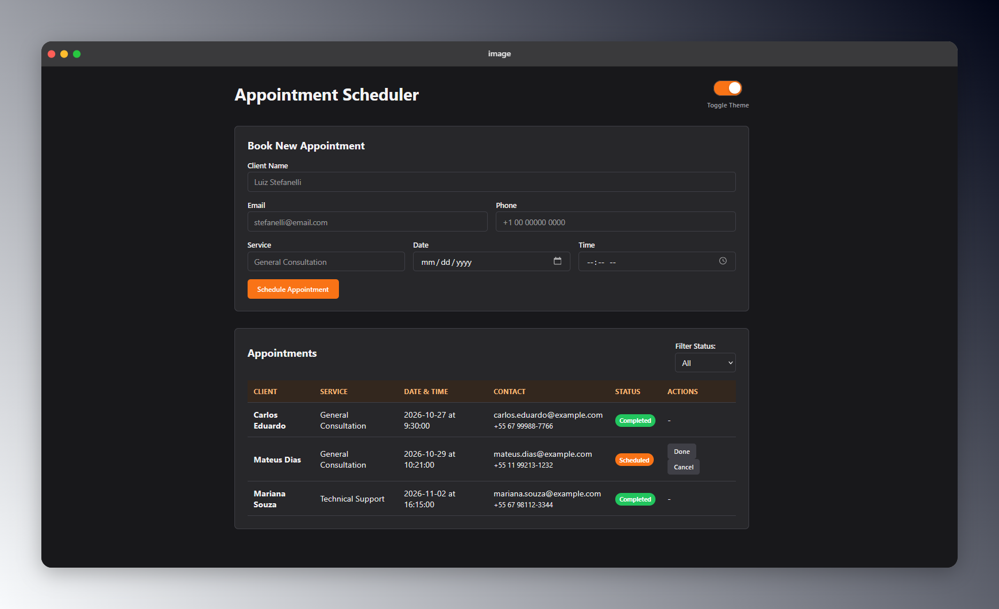
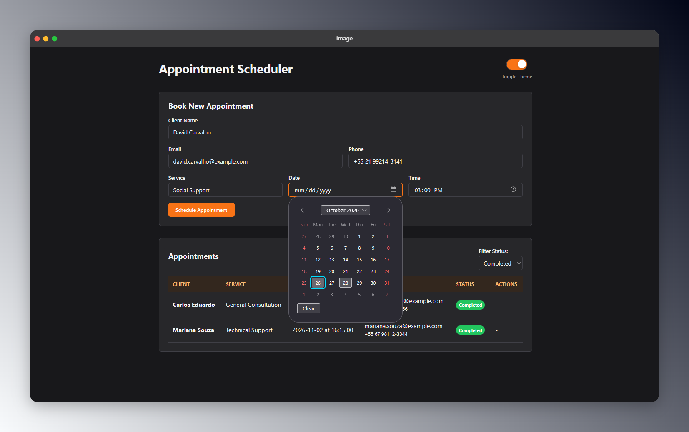
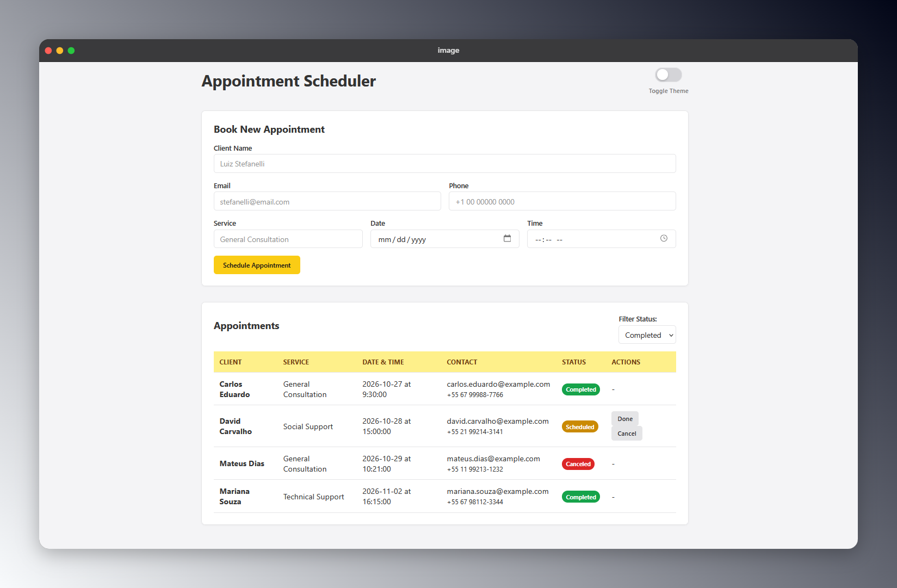
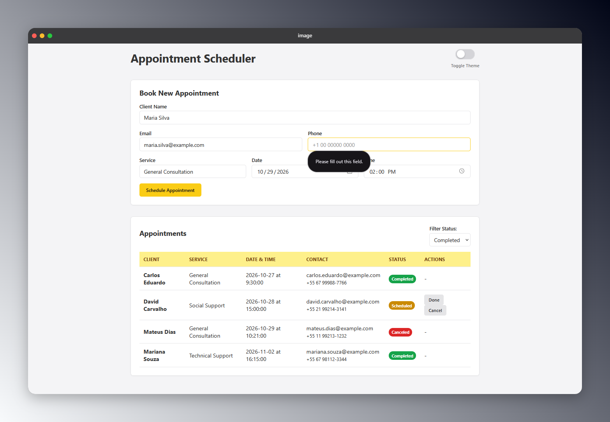

# Appointment Scheduling System

A simple, modern, and lightweight web application designed to manage, track, and schedule appointments efficiently.

## Tech Stack

- Frontend: HTML5, CSS3, JavaScript (Fetch API)
- Backend: Python (Flask / FastAPI)
- Database: MariaDB
- Authentication/ORM: (Optional / To be implemented)

## Screenshots

### Dark Theme

### Light Theme

## Run system

- first, execute app.py
- after execute index.html

> [!NOTE]
> This method of running the system will be improved in future updates!